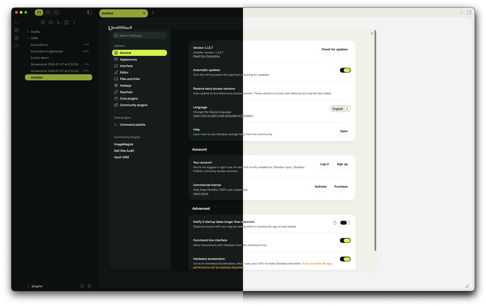

# Safi V2

A rounded, clean Obsidian theme. Notes sit on white cards over a soft paper page, corners are round everywhere, and one lime colour marks whatever is active, whether that's the open tab, the current file or the settings section you're in. Green is the brand. Headings are heavy and tight; everything else is a calm sans in two greys.

Pulled from the rounded design style at [abdulkadersafi.com](https://abdulkadersafi.com).

## Both modes

Light mode is paper `#EFF2E9` with white `#FFFFFF` cards, sunken fields in `#E3E9D9`, ink text `#101614` and green `#0E653F`. Dark mode swaps in a page of `#0C110F`, cards of `#151C19`, fields of `#202A26`, text in `#EEF2EA` and a lighter green, `#5FD394`, so links stay readable.

Both use lime `#D6F24E` with ink text for the active item. Never as text on light: it fails contrast.

Switch modes under Settings > Appearance > Base color scheme.

## What you get

- Each note pane is a white card with 24px corners and a soft shadow that only shows at the bottom edge. Sidebars and tab strips sit on the paper colour.
- Tabs are pills. The active tab, the active file in the file tree, the selected sidebar icon and the open settings section are all lime pills.
- Main buttons are ink pills. Text fields are sunken fills with 16px corners and no border. Toggles and checkboxes turn ink with a lime mark when on.
- Code blocks, callouts and images use 16px corners. Tags are sunken pills.
- In settings, each group is a white card on paper, so inputs stay visible.
- Tables fill the full content width, and the readable line length goes up to 1440px.

## Fonts

Funnel Display for headings and the inline title, Funnel Sans for everything else, JetBrains Mono for code only.

The theme loads them from Google Fonts, so the first load needs an internet connection. After that they are cached. To work fully offline, install the three fonts on your system. If Funnel is missing, the theme falls back to Wix Madefor Display and Text, then Host Grotesk.

## Install

1. Copy the `Safi-V2` folder into your vault at `.obsidian/themes/Safi-V2`. The folder name must match the `name` in `manifest.json` exactly, capital V included, or Obsidian won't list it.
2. In Obsidian, open Settings > Appearance > Themes and pick **Safi-V2**. If it doesn't appear, reload Obsidian.

## Customise

The colour tokens sit near the top of `theme.css`, under `.theme-light` and `.theme-dark` (`--surface-page`, `--surface-card`, `--surface-accent`, `--text-brand` and so on). A shared block below them maps those tokens onto Obsidian's own variables, so to retheme you only edit the tokens.

To change the brand, swap the green. You can also replace lime with another bright accent, as long as ink text stays readable on it.

## Support

If this theme is useful, you can support the work at [ko-fi.com/abdulkadersafi](https://ko-fi.com/abdulkadersafi).
